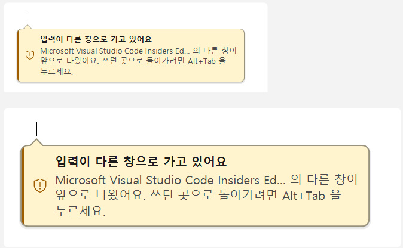
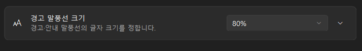

# 경고 말풍선 크기 설정과 잘리던 설명

2026-11-13 에 받은 신고: Xshell 에서 SSH 암호를 치던 중 포커스 뺏김 경고가 떴는데, 글자가 너무 크고 문장이 끝까지 보이지 않았습니다.
말풍선에는 "Xshell: Powerful TELNET/SSH terminal emu… 의 다른 창이 앞으로 나왔어요. 쓰던 곳으로 돌아가려면 Alt+Tab 을…" 까지만 보였고,
정작 해야 할 일인 "Alt+Tab 을 누르세요" 가 잘렸습니다.

이제 설정 → 실험 기능 → **경고 말풍선 크기**에서 말풍선 크기를 직접 고를 수 있고, 설명은 네 줄까지 보입니다. 앱 이름은 "Xshell" 처럼
짧게 들어갑니다.

## 왜 컸고, 왜 잘렸나

**크기.** 말풍선 배율은 모니터 배율 × (배지 크기와 Windows 텍스트 크기 중 큰 쪽)이고, 100% 아래로는 줄지 않았습니다(VW-04,
`CalloutStyle.Scale`). 배지를 크게 쓰는 사람은 경고도 함께 커지는데, 이를 따로 줄일 방법이 없었습니다. 배율 150% 모니터라면 배지 크기가
100% 여도 글자는 20px 입니다.

**잘림.** 원인은 두 가지가 겹쳤습니다.

| 원인 | 전 | 후 |
|---|---|---|
| 설명 줄 수 제한 (`OverlayRenderer.DetailLines`) | 2줄, 넘치면 마지막 줄 끝에 말줄임표 | 4줄 |
| 앱 이름 (`BadgeForm.AppName`) | 실행 파일 설명(FileDescription)을 40자에서 자름: "Xshell: Powerful TELNET/SSH terminal emu…" | "이름: 설명" 꼴이면 콜론 앞만 씀: "Xshell". 그래도 길면 40자에서 자름(`CalloutText.ShortAppName`) |

설명 한 줄의 최대 폭은 배율 1 에서 360px 이고 배율과 함께 커지므로, 크기를 바꿔도 줄 수는 같습니다. 앱 이름이 최대 길이(40자)여도 세 줄에
들어갑니다.

## 설정

| 값 | 말풍선 배율 |
|---|---|
| 자동 (배지 크기 따라, 기본) | 모니터 배율 × (배지 크기와 Windows 텍스트 크기 중 큰 쪽, 100~225%). 예전과 같습니다 |
| 70% · 80% · 90% · 100% · 115% · 130% · 150% | 모니터 배율 × 고른 비율. 배지 크기와 Windows 텍스트 크기는 보지 않습니다 |

- 설정 파일의 `CalloutSizePercent` 입니다. 0 이 자동이고, 손으로 고친 값은 50~200% 로 맞춥니다(음수는 자동). 고르기 상자에 없는 값이면
  "N%" 로 맨 끝에 더해 보여 줍니다.
- 항목이 없는 예전 설정 파일은 자동으로 읽히고, 구버전은 이 항목을 모르는 항목으로 무시하므로 되돌려도 다른 설정은 그대로입니다.
- 비밀번호 칸 경고, 포커스 뺏김 경고, 소나의 "커서를 찾지 못했어요" 안내가 모두 이 크기를 따릅니다. 소나 원의 크기는 그대로 배지 크기를 따릅니다.
- 바꾼 뒤 같은 페이지의 [보기] 단추로 바로 확인할 수 있습니다. 설정은 바꾸는 즉시 반영됩니다.
- 니모닉은 Alt+Z(한국어 "경고 말풍선 크기(&Z)", 영어 "Warning si&ze") 로 실험 기능 페이지의 다른 항목과 겹치지 않습니다.

## 코드

| 파일 | 바뀐 것 |
|---|---|
| `src/ImeBadge.Core/CalloutStyle.cs` | `AutoSize`·`MinSizePercent`·`MaxSizePercent`·`SizePresets`, `Scale(dpi, size, textScale, calloutPercent)` |
| `src/ImeBadge.Core/CalloutText.cs` | `ShortAppName`: 콜론 앞 이름, 40자 자르기 |
| `src/ImeBadge.Core/Settings.cs` | `CalloutSizePercent` 와 그 정규화·복사 |
| `src/ImeBadge/App/SettingsForm.cs` | 실험 기능 페이지의 고르기 상자 |
| `src/ImeBadge/App/CaretOverlays.cs`, `BadgeForm.cs` | `CalloutPlayer.Show` 에 말풍선 크기를 넘김, 앱 이름 줄이기 |
| `src/ImeBadge/Render/OverlayRenderer.cs` | 설명 최대 4줄 |
| `src/ImeBadge/Render/RenderSheet.cs` | 확인 시트 11절에 "포커스 뺏김 경고: 긴 앱 이름" 줄 |

## 확인

- 단위 테스트: `CalloutStyleTests.Scale_UsesChosenCalloutSize`(고른 크기가 배지·텍스트 크기를 이김, 200% 상한, 0 은 자동),
  `CalloutTextTests.ShortAppName_KeepsTheNameBeforeTheColon`, `SettingsStoreTests.Load_NormalizesCalloutSize`(없음·음수·범위 밖·저장·복사),
  `StringsTests` 의 니모닉 중복 검사.
- `--render-sheet` 11절의 긴 앱 이름 줄(위 그림)과 `--render-settings` 의 실험 기능 페이지(한국어·영어).
- 실제 화면 확인은 [test-matrix.md](test-matrix.md) 3-1절 "경고 말풍선 크기" 줄입니다.
