# ImeBadge View 개선 PRD

| 항목 | 내용 |
|---|---|
| 문서 상태 | v0.2 — 구현 진행 중. 현재 상태는 0.1 진행 요약과 0.3 보드 |
| 작성일 | 2026-10-12 |
| 기준 코드 | 로컬 `codex/ux-improvements` c0b3117 (1.15.1 + UX-01~17 반영 개발 빌드). 작업 브랜치 `codex/view-improvements` |
| 범위 | 사용자 눈에 보이는 것 전부: 커서 옆 오버레이(소나·말풍선), 배지 본체, 트레이 아이콘, 설정 창, 대화상자. 동작(판정·타이밍)은 범위 밖이고 부록 B 에만 적음 |
| 선행 문서 | `docs/ux-improvement-prd.md` (UX-01~17). 이 문서의 ID 는 `VW-NN` 으로 구분 |

---

## 0. 작업 현황 (항상 여기부터)

> **이 절은 작업 보드입니다.** 항목을 시작·완료할 때마다 아래 0.1 진행 요약과 0.3 상태 보드를 **코드와 같은 PR 에서** 고칩니다.
> "지금 무엇이 끝났고 무엇이 남았는가"는 이 절만 보면 알 수 있어야 합니다. 3장의 상세는 보드에서 ID 를 눌러 찾아갑니다.

### 0.1 진행 요약

| 구분 | 수 |
|---|---|
| 전체 | 14 |
| ✅ 완료 | 0 |
| 🔍 검토 중 | 9 |
| 🔄 진행 중 | 0 |
| ⬜ 대기 | 5 |
| ⏸ 보류 · ❌ 취소 | 0 |

**다음에 할 것(Next up)**: M4 의 VW-06 → VW-10 → VW-11 → VW-13 → VW-14. M1~M3 는 로컬 커밋으로 검토 대기. 결정 필요 항목: VW-10 의 방식.

### 0.2 상태 표기와 절차

| 표기 | 뜻 | 바꾸는 시점 |
|---|---|---|
| ⬜ 대기 | 아직 시작하지 않음 | - |
| 🔄 진행 중 | 브랜치를 만들고 구현 중 | 브랜치를 만든 직후 |
| 🔍 검토 중 | 로컬 커밋 또는 PR 로 리뷰·수동 검증 대기 | 커밋·PR 을 만든 직후 |
| ✅ 완료 | `main` 에 병합됨 | 병합 직후 |
| ⏸ 보류 | 결정 대기 또는 의존 항목 대기. 메모란에 사유 | 막힌 것을 안 즉시 |
| ❌ 취소 | 하지 않기로 함. 메모란에 사유 | 결정 직후 |

한 항목을 끝내는 절차 (UX PRD 0.2 와 같음):

1. **고르기** — 0.3 보드에서 항목을 고르고, 0.4 의 의존 항목이 ✅ 인지, 3장 그 항목에 "결정 필요"가 남아 있지 않은지 봅니다. 남아 있으면 먼저 결정하고 **결정** 란에 결론과 날짜를 적습니다.
2. **시작 표시** — 보드 상태를 🔄 로, 브랜치 이름을 적습니다. UX PRD 처럼 `codex/view-improvements` 한 브랜치에 마일스톤마다 커밋하고, PR 로 나눌 때 `codex/vw-NN-짧은이름` 을 씁니다. 0.1 진행 요약의 수를 맞춥니다.
3. **구현** — 3장 항목의 **완료 조건** 체크박스를 채우면서 구현합니다. **구현 가이드**의 파일·줄 번호는 출발점이지 제약이 아닙니다. 완료 조건을 바꿔야 하면 지우지 말고 ~~취소선~~ 과 사유를 덧붙입니다.
4. **검증** — 0.5 공통 검증과 항목의 **검증** 체크박스를 채웁니다. 그림을 바꾼 항목은 **전후 캡처**를 `docs/images/view-prd/` 에 넣고 항목에 링크합니다.
5. **문서 갱신** — `CHANGELOG.md` 의 `[Unreleased]`, 문구·설정이 바뀌었으면 `README.md`, 수동 확인 항목이 생겼으면 `docs/test-matrix.md`.
6. **PR** — 보드 상태를 🔍 로, PR 번호를 적습니다. 병합되면 ✅ 로 바꾸고 0.6 작업 로그에 한 줄, 0.1 진행 요약의 수를 맞춥니다.

규칙:

- 한 PR 에 한 항목이 원칙. 같은 마일스톤의 작은 항목은 묶어도 되고, 묶으면 보드에 같은 PR 번호를 적습니다.
- 문구를 더하거나 바꾸면 `src/ImeBadge.Core/Strings.cs` 의 **한국어·영어 둘 다**. `StringsTests` 가 키 일치·자리표시자·니모닉 중복을 검사합니다.
- 설정 파일 호환: 새 설정 키의 기본값은 "예전과 같은 동작". 기본 모습 자체를 바꾸는 항목(VW-02 · 03 · 07 · 08)은 CHANGELOG 에 "모습이 달라집니다" 를 적습니다.
- 그리기 코드는 기존 방식(GDI+ 미리 곱한 알파 비트맵 → 레이어드 창)을 유지합니다. 새 렌더링 기술(Direct2D 등)은 이 문서 범위 밖입니다.
- 고대비 모드는 늘 시스템 색 그대로(기존 원칙). 모든 항목에서 `SystemInformation.HighContrast` 분기를 깨지 않습니다.
- 실제 눈으로 시험하다 찾은 문제는 0.7 표에 `V-N` 번호로 적고, 고치면 관련 항목의 **검증** 란과 `docs/test-matrix.md` 를 함께 바꿉니다.

### 0.3 상태 보드

| ID | 제목 | 영역 | 우선순위 | 마일스톤 | 상태 | 브랜치 / PR | 메모 |
|---|---|---|---|---|---|---|---|
| VW-01 | 말풍선 글자 가독성 (크기·색·ClearType·정수 스냅) | 오버레이 | P1 | M1 | 🔍 | `codex/view-improvements` (로컬 커밋, PR 전) | 13px 정수 px·ClearType·설명색 10:1. 실제 화면 확인은 VW-14 |
| VW-02 | 말풍선 몸통이 흰 문서와 구분되게 (채움·테두리·색 띠) | 오버레이 | P1 | M1 | 🔍 | `codex/view-improvements` (로컬 커밋, PR 전) | 강조색 섞은 바탕·3:1 테두리·색 띠 |
| VW-03 | 소나 원·끝 빛을 또렷하게 (알파 곡선·이중 윤곽·멈춤 장면) | 오버레이 | P1 | M2 | 🔍 | `codex/view-improvements` (로컬 커밋, PR 전) | 결정 (a) 속이 빈 캡슐 윤곽. 2차 ease-out·85% 부터 옅어짐·짝 색 |
| VW-04 | 오버레이가 배지 크기·Windows 텍스트 크기를 따르게 | 오버레이 | P2 | M3 | 🔍 | `codex/view-improvements` (로컬 커밋, PR 전) | 말풍선 = 배율 × max(배지 크기, 텍스트 크기) 100~225%, 소나 = 배율 × 배지 크기 100~200% |
| VW-05 | 오버레이 z-order: 최상위 활성 창 위에 유지 | 오버레이 | P3 | M4 | 🔍 | `codex/view-improvements` (로컬 커밋, PR 전) | `TopmostRaiser` 로 배지 로직을 빼서 말풍선·소나도 사용. 실제 확인은 VW-14 |
| VW-06 | 말풍선 [보기] 미리보기 + 확인 시트 100% 행 | 오버레이·설정 창 | P3 | M4 | ⬜ | | VW-01·02 뒤 |
| VW-07 | 밝은 배지색이 흰 문서 위에서 윤곽이 약함 — 바깥 어두운 림 | 배지 | P1 | M2 | 🔍 | `codex/view-improvements` (로컬 커밋, PR 전) | 같은 색조 진한 바깥 림(`OuterShadeAlpha`). 배지·트레이 공통 |
| VW-08 | 점·밑줄 모양의 특수 키 표시(▲ ▁ ■)가 너무 작음 | 배지 | P2 | M2 | 🔍 | `codex/view-improvements` (로컬 커밋, PR 전) | ▲ 6×4 · ▁ 9×2 · ■ 4×4. 결정: 점의 Caps Lock 은 ▁ 유지 |
| VW-09 | 아래쪽 배치에서 배지가 다음 줄 글자를 가림 | 배지 | P2 | M3 | 🔍 | `codex/view-improvements` (로컬 커밋, PR 전) | 결정 (d): 배치 유지 + 위치 카드에서 '타이핑 중에는 옅게' 로 잇는 안내 |
| VW-10 | 트레이 아이콘 16px "한" 뭉개짐 | 트레이 | P3 | M4 | ⬜ | | |
| VW-11 | 불투명 배지 글자에 ClearType 적용 검토 | 배지 | P3 | M4 | ⬜ | | VW-01 의 기법 재사용. 효과 측정 뒤 결정 |
| VW-12 | 대화상자(TaskDialog)가 어둡게 모드를 따르지 않음 | 대화상자 | P2 | M3 | 🔍 | `codex/view-improvements` (로컬 커밋, PR 전) | `ThemedDialog`. 고대비·치명적 오류는 TaskDialog 유지. 시트 13절 |
| VW-13 | 설정 창 미리보기에 "문서 위 가독성" 상황 추가 (선택 영역·흰 문서·어두운 편집기) | 설정 창 | P3 | M4 | ⬜ | | VW-07 뒤 |
| VW-14 | 밝게 앱 모드·고대비·125/150% 배율 전수 캡처 검증 | 전체 | P2 | M4 | ⬜ | | 이 PC 는 어둡게·100% 만 확인됨 |

### 0.4 의존 관계와 권장 순서

```
M1  VW-01 → VW-02                말풍선. OverlayRenderer.cs 한 파일 중심. 한 PR 로 묶어도 됨
M2  VW-07 → VW-03 → VW-08        윤곽. VW-07 이 만드는 "밝은 색의 바깥 어두운 림" 함수를 VW-03(소나 원)·VW-08(표시 기호)이 쓴다
M3  VW-04 · VW-09 · VW-12        서로 독립. VW-09 는 결정 먼저
M4  VW-05 · VW-06 · VW-10 · VW-11 · VW-13 · VW-14   독립. VW-06·13 은 M1·M2 뒤에 해야 바뀐 모습을 미리보기에 담는다
```

### 0.5 공통 검증

- [ ] `dotnet build ImeBadge.sln` (경고 = 오류) · `dotnet test`
- [ ] 그리기를 건드렸으면 `dotnet run --project src/ImeBadge -- --render-sheet sheet.png` 로 시트가 깨지지 않는지. **바뀐 절을 전후로 캡처**해 `docs/images/view-prd/` 에 둔다
- [ ] 오버레이를 건드렸으면: 흰 문서(메모장) · 어두운 편집기(VS Code) · 밝게/어둡게 앱 모드 · 고대비 · 100%·150% 배율에서 눈으로 확인
- [ ] 설정 창을 건드렸으면: 밝게/어둡게 · 고대비 · 100%·150% · 한국어·English 에서 잘림·겹침·스크롤바 확인
- [ ] `docs/test-matrix.md` 의 관련 행
- 팁: 앱이 떠 있을 때 `ImeBadge.exe` 를 한 번 더 실행하면 설정 창이 열립니다. 설치본이 떠 있으면 개발 빌드는 설정 창만 열고 끝나니, 개발 빌드로 보려면 설치본을 먼저 끕니다(끝나면 다시 켜고 `%APPDATA%\ImeBadge\settings.json` 이 그대로인지 해시로 확인).

### 0.6 작업 로그

| 날짜 | ID | 내용 | PR |
|---|---|---|---|
| 2026-10-12 | - | PRD 초안. 근거는 개발 빌드(c0b3117)의 `--render-sheet` 출력, 설정 창 6페이지 캡처(어둡게·100%), 자체 입력창에서 배지 캡처, 100% 배율 말풍선 재현 실험 | - |
| 2026-10-12 | VW-01 · 02 | M1: 말풍선 글자 13px 정수 px·ClearType·설명색 10:1, 강조색 섞은 바탕·3:1 테두리·색 띠. 색 규칙을 Core `CalloutStyle` 로 옮기고 테스트 56건. 확인 시트 11절에 100% 줄 | 로컬 커밋(M1) |
| 2026-10-12 | VW-07 | 밝은 배지의 바깥 진한 림(UX-01 의 거울상). 배지·점·밑줄·캐릭터·표시 기호·트레이 공통, 테스트 18건 | 로컬 커밋(M2-1) |
| 2026-10-12 | VW-03 | 소나: 속이 빈 캡슐 윤곽, 2차 ease-out·끝 15% 에서만 옅어짐, 짝 색(밝은 색 = 진한 테두리), 멈춘 한 장 불투명. 테스트 8건, 시트 10절 3줄 추가. 실제 화면 확인은 PC 잠김으로 못 함 | 로컬 커밋(M2-2) |
| 2026-10-12 | VW-08 | 점·밑줄 아래 표시 기호 키움(▲ 6×4, ▁ 9×2, ■ 4×4), 치수를 Core 로 옮기고 자리 맞춤 테스트 6건 | 로컬 커밋(M2-3) |
| 2026-10-12 | VW-04 | 말풍선·소나가 배지 크기(·텍스트 크기)를 따름. `CalloutStyle.Scale`·`Sonar.Scale`(Core) + 테스트 12건, `Theme.TextScalePercent` | 로컬 커밋(M3-1) |
| 2026-10-12 | VW-09 | 결정 (d): 배치 유지, 위치 카드 자세히 설명에 '타이핑 중에는 옅게' 안내(한·영). 기하 변경 완료 조건 2개는 취소선 | 로컬 커밋(M3-2) |
| 2026-10-12 | VW-12 | 테마를 입힌 `ThemedDialog`(아이콘·제목·본문·명령 링크·자세히), `Dialogs` 가 먼저 쓰고 고대비·실패면 TaskDialog. 확인 시트 13절 | 로컬 커밋(M3-3) |
| 2026-10-12 | VW-05 | `TopmostRaiser` 로 최상위 올리기를 공용화, 말풍선·소나가 보일 때마다 최상위 활성 창 위로 | 로컬 커밋(M4-1) |

### 0.7 실기 테스트 기록

| # | 발견 | 관련 | 조치 | 결과 |
|---|---|---|---|---|
| V-1 | (조사 중) 사용자 설정(미드나잇 테마, 점 모양, 130%)의 금색 점이 흰 입력창 위에서 대비 1.6:1 — 윤곽이 거의 없음 | VW-07 | 바깥 진한 림 | 🔍 시트로 확인, 실제 화면은 VW-14 |
| V-2 | (조사 중) 설정 창 모양 페이지 미리보기에서 아래쪽 배치의 점이 다음 줄 "헌" 글자 위에 겹침 | VW-09 | 아래 배치의 본질로 판단, 안내 추가(결정 (d)) | 🔍 |
| V-3 | 2026-10-12 VW-03 실제 화면 확인 중 PC 가 잠겨(LogonUI) 화면 캡처·창 전환이 실패. 개발 빌드를 끄고 설치본·설정 파일을 되돌림(해시 일치) | VW-03·14 | 실제 화면 확인은 VW-14 로 모음 | ⏸ |

---

## 1. 배경

1.15.0 의 실험 기능으로 커서 옆에 **말풍선**과 **소나**가 생겼고, UX-01~17 로 설정 창이 Windows 11 설정 앱 모양이 되었습니다.
그런데 실제로 써 보면 **"모양과 글자가 흐리게 보인다"** 는 체감이 남습니다. 조사 결과 원인은 한 가지가 아니라 다음이 겹친 것입니다.

| 원인 | 어디서 | 근거 |
|---|---|---|
| 작은 Regular 글자 + 회색 안티앨리어싱 + 연한 색 | 말풍선 설명 줄(12px, #5F5F5F) | 1.1 그림 |
| 흰 말풍선이 흰 문서와 구분되지 않음 | 정보(Info) 말풍선 채움 #FFFFFF, 테두리 #DBDBDB(대비 1.38) | 1.1 그림 |
| 반투명 채움으로 그린 "빛"이 번짐으로 보임 | 소나 끝 장면 | 1.2 그림 |
| 밝은 배지색은 흰 문서 위에서 윤곽이 없음 | 미드나잇 금색 1.60 · 민트 1.68 · 벚꽃 2.04 (vs 흰색) | 1.3 표 |
| 작은 표시 기호 | 점·밑줄 모양의 ▲ ▁ ■ (100% 에서 3px) | 1.4 그림 |

### 1.1 말풍선 — 지금(위)과 개선안(아래), 100% 배율 3배 확대

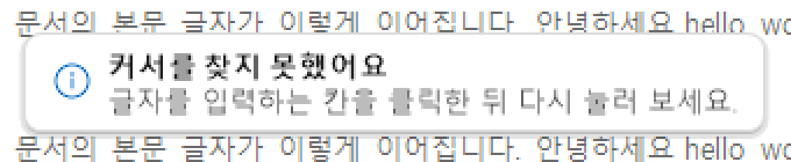
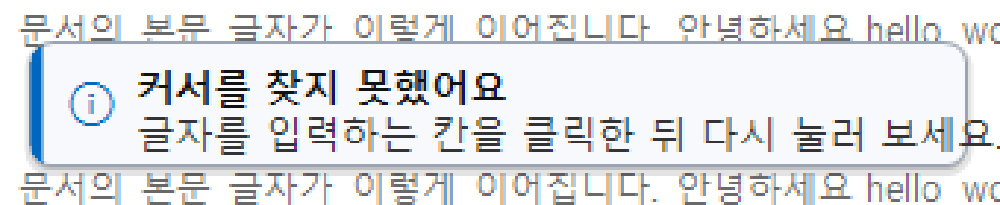

개선안은 글자 13px · ClearType · 설명색 #333 · 테두리 진하게 · 왼쪽 강조색 띠. 같은 흰 문서 위입니다.
(재현 실험: 같은 글꼴·크기·힌트로 PowerShell 에서 그린 것. 앱 코드로 그린 전후 비교는 VW-01·02 구현 때 이 자리에 바꿔 넣습니다.)

### 1.2 소나 끝 장면 (5배 확대)

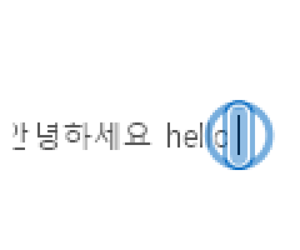

커서와 옆 글자 위에 반투명 색(alpha 110)이 덮여 "얼룩"처럼 보입니다.

### 1.3 테마 기본색의 배경 대비 (WCAG 대비율)

| 테마 | 한 vs 흰 문서 | 한 vs 어두운 편집기(#1E1E1E) | a vs 흰 | a vs 어두운 |
|---|---|---|---|---|
| 클래식 | 5.67 | 2.94 | 11.03 | **1.51** (UX-01 흰 림으로 해결) |
| 벚꽃 | **2.04** | 8.16 | 3.44 | 4.85 |
| 캔디 | **2.74** | 6.09 | 4.78 | 3.49 |
| 민트초코 | **1.68** | 9.94 | 7.88 | 2.12 |
| 미드나잇 | **1.60** | 10.4 | 7.93 | 2.10 |

어두운 배지가 어두운 바탕에서 안 보이는 것(UX-01)은 바깥 **흰** 림으로 풀었지만, 그 거울상 — **밝은 배지가 흰 바탕에서 안 보이는 것** — 은 아직 없습니다.
배지 테두리(`ColorHex.EdgeOn`)는 배지색과의 대비 1.6 을 목표로 하므로 금색 배지의 테두리는 흰색과 약 2.5:1 로 1px 뿐입니다.

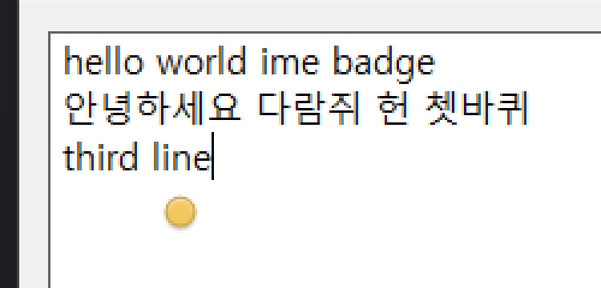

### 1.4 점·밑줄 모양의 특수 키 표시 (100%, 150%, 100%×3)

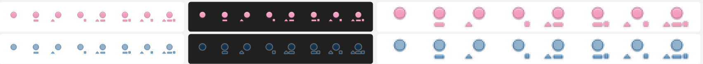

100% 에서 ▲(3px)·■(3px)·▁(7×2px) 은 서로 구별하기 어렵고, 벚꽃·30% 불투명도에서는 점 자체가 묻힙니다.

### 1.5 트레이 아이콘 (16 · 20 · 24 · 32px, 어두운 작업 표시줄, 16px×4)

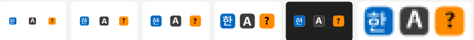

### 1.6 설정 창 (어둡게 · 100%)

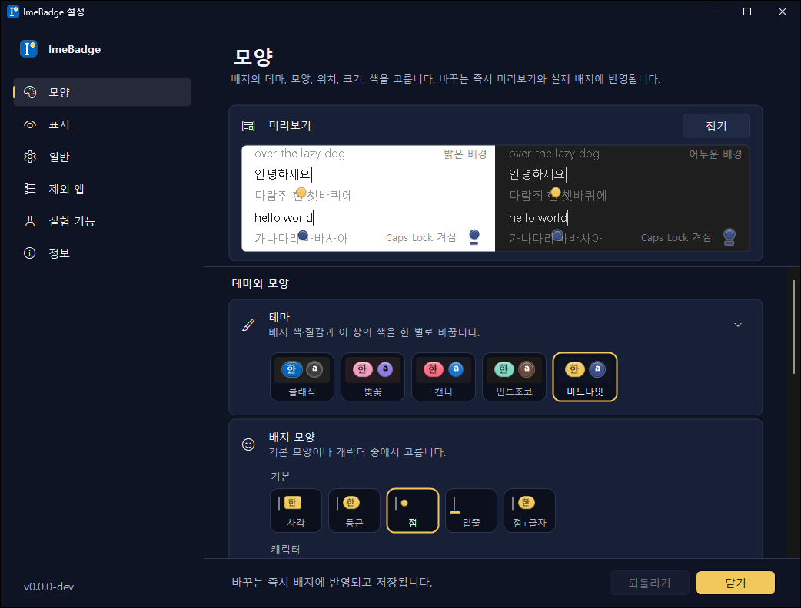

설정 창 자체는 UX-01~17 로 정돈되어 큰 문제는 없습니다. 미리보기에서 아래쪽 배치의 점이 다음 줄 글자에 겹치는 것(V-2)은 미리보기의 거짓이 아니라 **실제 동작과 같은** 모습이라 VW-09 로 다룹니다.

## 2. 목표와 비목표

**목표**

- 커서 옆 오버레이(말풍선·소나)가 100% 배율 흰 문서 위에서도 "또렷하다"고 느껴진다: 글자 획이 1px 이상, 몸통 윤곽이 보이고, 반투명 번짐이 없다.
- 어떤 테마의 어떤 배지 모양도 흰 문서·어두운 편집기 양쪽에서 **윤곽이 3:1 이상**으로 보인다(UX-01 기준을 양방향으로).
- 특수 키 표시는 100% 에서도 ▲ ▁ ■ 이 구별된다.
- 설정 창·대화상자·트레이가 하나의 테마(밝게/어둡게)로 보인다.

**비목표**

- 새 배지 모양·새 테마 추가, 애니메이션 종류 추가.
- 판정·타이밍 로직(소나 자동 재생 조건, 포커스 뺏김 판정, 한/영 유지)의 변경 — 부록 B 에 관찰만 남긴다.
- GDI+ 를 Direct2D/DirectWrite 로 바꾸는 일.

## 3. 항목 상세

각 항목은 **문제 → 근거 → 제안 → 완료 조건 → 구현 가이드 → 검증 → 결정** 순서입니다. 줄 번호는 c0b3117 기준입니다.

---

### VW-01 · 말풍선 글자 가독성 (P1 · M1)

**문제** 말풍선 제목 12.5px Bold, 설명 12px Regular 를 회색 안티앨리어싱으로 그려 100% 배율에서 설명 줄이 번져 보인다. 설명색이 설정 창 보조 텍스트색(#5F5F5F / 어둡게 #B0B0B0)이라 더 옅다. 글자 원점이 .5 픽셀에 놓인다.

**근거** 1.1 그림. `OverlayRenderer.cs:99` `TitleSize = 12.5f, DetailSize = 12f`, `:166` `detail = p.SubtleText`, `:195, 219` `AntiAliasGridFit`, `:241-258` 원점 `rect.X + PadX*scale`(rect.X 가 +0.5).

**제안**

1. 글자 크기: 제목 13px Bold, 설명 13px Regular. 픽셀 크기는 `MathF.Round(size * scale)` 로 정수.
2. 설명색: Info 는 `p.Text` 에 가깝게(밝게 #333333, 어둡게 #E0E0E0), Warning 은 지금 값 유지(#4A4A4A / #E3DCC6 는 충분).
3. ClearType: 몸통은 불투명하므로, 몸통 path 안쪽(채움 + 글자 + 아이콘)을 `Format32bppRgb` 보조 비트맵에 `ClearTypeGridFit` 으로 그린 뒤 `SetClip(path)` 로 PArgb 그림에 합성한다. 꼬리·그림자·둥근 모서리의 투명도는 그대로.
4. 글자·아이콘 원점을 `MathF.Round` 로 정수에 맞춘다(`BadgeRenderer.DrawCentered` 의 `snap: true` 와 같은 이유).
5. 창 전체 알파 페이드(`SourceConstantAlpha`)는 유지(ClearType 글자가 페이드 중 색 번짐을 보이면 페이드인을 80ms 로 줄인다).

**완료 조건**

- [x] 100% 배율 흰 문서 위 말풍선 설명 줄의 획이 끊기지 않고 1px 이상으로 보인다(3배 확대 캡처로 전후 비교) — 아래 결과 그림
- [x] 125%·150% 에서 글자 크기가 정수 px 로 계산된다(단위 테스트: `OverlayRenderer` 의 크기 계산을 Core 로 빼거나 내부 함수로 노출) → `CalloutStyle.FontPx`(Core) + `CalloutStyleTests.FontPx_IsWholePixels`
- [x] Info 설명색의 흰·어두운 바탕 대비가 각각 10:1 이상 → `ClassicInfoDetail_IsAtLeast10To1`, 모든 테마·종류는 7:1 이상(`Text_IsHighContrast`)
- [x] 고대비 모드에서는 시스템 색·회색 AA 그대로(ClearType 경로를 타지 않는다) (코드 경로: `ClearTypeText` 가 고대비면 false. 화면 확인은 VW-14)
- [x] `RenderSheet` 11절이 바뀐 모습을 보여 준다 (100% 줄도 더함 — VW-06 의 일부)

**구현 가이드** `src/ImeBadge/Render/OverlayRenderer.cs` — `CalloutFonts`(글꼴 생성), `ColorsFor`(색), `Callout`(그리기). ClearType 합성은 `Callout` 안에서 몸통을 먼저 보조 비트맵에 그리고 `g.SetClip(path); g.DrawImage(opaque, …); g.ResetClip()`. `MeasureCallout` 과 `Callout` 이 `CalloutFonts` 를 두 번 만드는 것도 이때 한 번으로 합친다.

**검증**

- [ ] 메모장(흰) · VS Code(어두운 편집기) · 밝게/어둡게 앱 모드 · 고대비 · 100%·150% — 확인 시트(밝게/어둡게 × 100%/150%)로 확인. 실제 화면·고대비는 VW-14
- [x] 비밀번호 칸 경고(둘 다)·포커스 뺏김 경고(긴 앱 이름)에서 두 줄 설명이 잘리지 않는다 (시트 11절)
- [x] 전후 캡처를 `docs/images/view-prd/` 에

**결정** 없음. 구현 중 정한 것(2026-10-12): 설명색은 제목색을 12% 옅게 하되 10:1 에 못 미치면 덜 옅게, `MaxText` 340 → 360(13px 로 커진 만큼), 아이콘 글리프는 ClearType 대신 회색 안티앨리어싱(색 번짐 방지), 재기·그리기가 같은 글꼴을 쓰도록 마지막 배율의 글꼴을 캐시.

**결과** (확인 시트 11절, 100% 실제 픽셀 · 왼쪽 두 칸 밝게, 오른쪽 두 칸 어둡게)

| 이전 | 이후 |
|---|---|
| 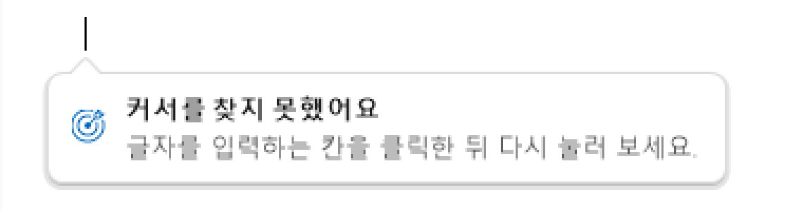 | 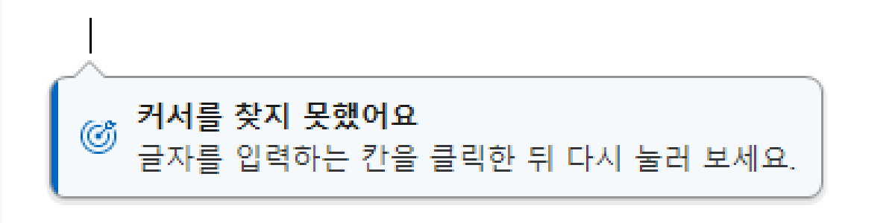 |

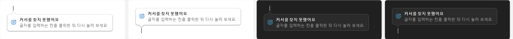
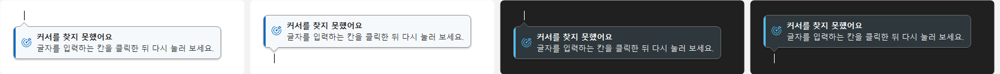
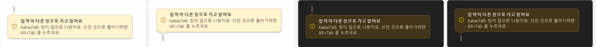
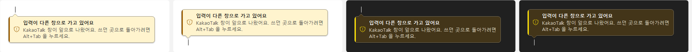

---

### VW-02 · 말풍선 몸통이 흰 문서와 구분되게 (P1 · M1)

**문제** 정보(Info) 말풍선의 채움이 테마 카드색(클래식 밝게 #FFFFFF)이고 테두리는 14% 섞은 #DBDBDB(흰색과 1.38:1). 메모장·Word·브라우저 같은 흰 문서 위에서 몸통이 묻히고 옅은 그림자만 남는다. 125% 에서 테두리 펜 1.25px 가 2px 반투명 선이 된다.

**근거** 1.1 그림. `OverlayRenderer.cs:166` `fill = p.Card`, `:169` 테두리 섞기 0.14/0.16, `:237` `new Pen(colors.Border, Math.Max(1f, scale))`, `:229-234` 그림자 두 겹.

**제안**

1. Info 채움: 순백 대신 강조색을 아주 조금 섞은 색(밝게 `Mix(Card, Accent, 0.04)` ≈ #F7F9FC, 어둡게 `Mix(Card, White, 0.04)`).
2. 테두리: 섞기 비율 0.14 → 0.38(밝게), 0.16 → 0.30(어둡게). 흰 문서 위 3:1 이상.
3. 종류별 **왼쪽 색 띠** 4px(배율 반영): Info = 테마 강조색, Warning = 주의 아이콘색. Windows 11 InfoBar 와 같은 문법.
4. 테두리 펜 굵기 `MathF.Round(scale)`(최소 1). 그림자는 테두리가 진해지는 만큼 옅게(alpha 28/40 → 20/28).
5. Warning 색은 유지(#FFF4CE / #433519 는 흰·어두운 문서 모두와 구분된다).

**완료 조건**

- [x] 흰 문서(#FFFFFF) 위 Info 말풍선 테두리 대비 3:1 이상, 어두운 편집기(#1E1E1E) 위 어둡게 Info 테두리 3:1 이상 → `CalloutStyleTests.Border_StandsOutFromTheDocument`(모든 테마 × 밝게/어둡게 × 정보/주의)
- [x] 색 띠가 둥근 모서리 안쪽에서 잘린다(path 로 클립) — 정수 폭 사각형으로 잘라 몸통 윤곽을 칠함
- [x] 125%·150% 에서 테두리가 한 픽셀 폭의 선으로 보인다 → `CalloutStyle.BorderWidth` + 선 가운데를 굵기의 절반 안쪽에
- [x] 고대비는 변경 없음(창 글자색 1px 테두리)

**구현 가이드** `OverlayRenderer.ColorsFor` 에 `Stripe` 색을 더하고 `Callout` 에서 채움 뒤·테두리 전에 `SetClip(path)` 하고 `FillRectangle`. `PadX` 를 띠 폭만큼 늘리거나 아이콘 x 를 띠 뒤로.

**검증** VW-01 과 같이. 추가로 "소나: 커서 못 찾음" 을 바탕화면(어두운 배경 그림)에서 띄워 띠·테두리가 보이는지.

**결정** 없음. 구현 중 정한 것(2026-10-12): 테두리는 고정 비율 대신 "문서 바탕과 3:1 이 되는 가장 옅은 색" 을 찾는다(테마마다 바탕이 달라서). 띠 뒤 여백 10px. 결과 그림은 VW-01 과 같음.

---

### VW-03 · 소나 원·끝 빛을 또렷하게 (P1 · M2)

**문제**

- 원의 알파 곡선(`Sonar.Ring`)이 출발 15% 동안 0→1, 70% 뒤 1→0 인데, ease-out 때문에 원은 p≈0.7 에 이미 끝 반지름에 도착한다. 그래서 **원이 커서 옆에 멈춘 채 서서히 사라지는** 구간이 길어 잔상처럼 보인다.
- 끝 "빛"이 8px 캡슐의 반투명 채움(alpha 110)이라 커서와 옆 글자를 덮는 얼룩으로 보인다(1.2 그림).
- 헤일로가 늘 흰색이라 흰 문서에서는 아무 역할이 없고, 금색·분홍·민트 원은 흰 문서 위에서 1.6~2:1 로 옅다(1.3 표).
- 애니메이션 효과를 끈 사용자에게 보이는 멈춘 한 장(`StillT = 0.7`)은 뒤 원 알파 0.65 로 처음부터 반투명이다.

**근거** `Sonar.cs:41` 알파식, `:28` StillT; `OverlayRenderer.cs:27` `RingWidth 3 / RingHalo 1.5`, `:60-83` 빛; `BadgeForm.cs:1228` `halo = Color.White`.

**제안**

1. 알파 곡선: 페이드아웃을 p 0.7→1.0 에서 **0.85→1.0** 으로 늦추고 짧게. 도착(p≥0.95) 뒤에는 바로 끊는다. 출발 램프는 0.15 → 0.08.
2. 끝 빛: 채움 없는 **이중 윤곽**(바깥 어두운 선 1px + 배지색 2px + 안쪽 흰 선 1px)의 캡슐, 또는 커서 막대 자체를 배지색으로 3px 굵게 긋는 것 중 하나(결정). 글자를 덮는 반투명 채움은 없앤다.
3. 원의 윤곽: 흰 헤일로 대신 **배지와 같은 이중 윤곽** — 바깥에 `ColorHex.EdgeOn`(같은 색조의 어두운 선), 안쪽에 흰 선. VW-07 이 만드는 "밝은 색의 바깥 어두운 림" 함수를 그대로 쓴다. 어두운 바탕에서는 흰 선이, 흰 바탕에서는 어두운 선이 윤곽을 맡는다.
4. 멈춘 한 장: StillT 를 쓰되 알파를 1 로 고정한 전용 장면(`Sonar.Still(…)`).
5. 소나 원 굵기는 배지 크기 설정을 따른다(VW-04 에서 함께).

**완료 조건**

- [x] `SonarTests`: 새 곡선에서 원이 끝 반지름의 2% 안에 들어온 뒤 알파가 0 이 되기까지의 시간이 전체의 10% 이하 → `Ring_DoesNotLingerAtTheCaret`(앞·뒤 원)
- [x] 끝 빛에 반투명 채움이 없다(커서 뒤 글자가 그대로 보인다)
- [x] 금색(#F2C75C) 원이 흰 문서 위에서 윤곽 3:1 이상(바깥 선 색으로 계산) → `LightRing_IsOutlinedOnWhite`
- [x] 멈춘 한 장의 원·빛 알파가 1 → `StillFrame_IsOpaque`
- [x] `RenderSheet` 10절에 "밝은 배경 · 미드나잇", "밝은 배경 · 벚꽃" 행을 더해 밝은 색에서도 보이는지 그림으로 남긴다 (미드나잇 밝게·어둡게, 벚꽃 밝게)

**구현 가이드** `src/ImeBadge.Core/Sonar.cs`(곡선·멈춤), `src/ImeBadge/Render/OverlayRenderer.cs` `Sonar`(그리기), `src/ImeBadge/App/BadgeForm.cs` `PlaySonar`(색·헤일로 결정 → 이중 윤곽 색 둘을 넘긴다), `CaretOverlays.cs` `SonarPlayer`.

**검증**

- [ ] 메모장(흰)·VS Code(어두운)에서 Ctrl+Alt+J: 원이 또렷하게 좁혀 들고 끝에 커서 자리가 분명히 표시된다 — 실제 화면 확인을 시도했으나 PC 가 잠겨 있어 화면 캡처 불가(0.7 V-3). VW-14 에서
- [ ] 미드나잇·벚꽃·민트 테마에서 흰 문서 위 원이 보인다 — 확인 시트 10절로 확인
- [x] Windows 애니메이션 효과 끔: 멈춘 한 장이 또렷하다 — 시트 10절 "멈춤" 칸(앱과 같은 `still: true` 경로)
- [ ] 설정 창 [보기] 도 같은 모습 — 같은 `PlaySonar` 경로

**결정** 끝 빛의 모양 — (a) 이중 윤곽 캡슐 / (b) 커서 막대 굵게 긋기. 결정(2026-10-12): **(a) 속이 빈 캡슐 윤곽**(짝 색 굵은 선 위에 배지색 2px). (b) 는 앱이 그린 커서 위에 덧칠해 터미널의 블록 커서·근사 위치(높이 0)에서 커서 모양을 바꿔 보이게 한다.

구현 중 정한 것: 이중 윤곽은 "바깥 진한 선 + 배지색 + 안쪽 흰 선" 세 겹 대신, 배지색 아래 **짝 색 한 겹**으로 했다(3px 원에 세 겹은 너무 붐빔). 짝 색은 배지색이 흰 문서와 3:1 이 안 되면 VW-07 의 같은 색조 진한 색, 아니면 흰색(`OverlayRenderer.SonarPartner`) — 한쪽 바탕은 배지색이, 다른 쪽 바탕은 짝 색이 맡는다. 움직임은 3차 → 2차 ease-out(커서 옆에서 덜 머묾), 원이 좁혀 드는 끝 반지름을 캡슐 바깥(`height/2 + 11px`)으로 잡아 사라지는 원과 캡슐이 겹쳐 얼룩지지 않게 했다. 멈춘 한 장은 `StillT` 0.7 → 0.6(뒤 원이 캡슐 둘레에 있는 순간).

**결과** (확인 시트 10절, 100%. 클래식 한 · 밝은 배경, 4배 확대)

| | 이전 | 이후 |
|---|---|---|
| 끝 장면(t=0.72) | 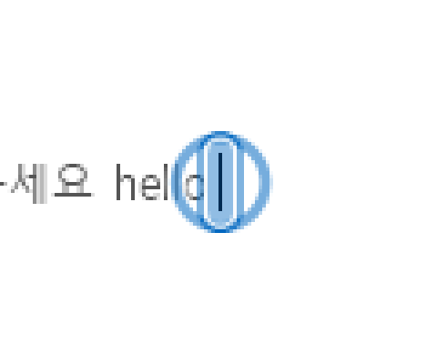 | 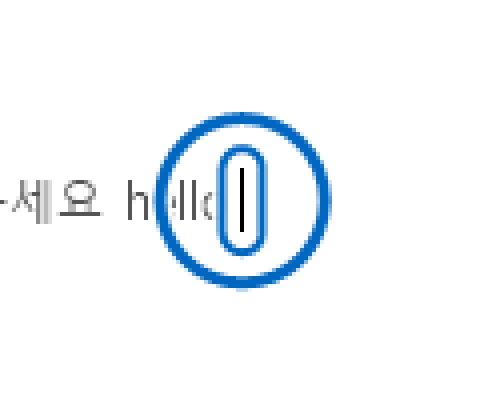 |
| 멈춘 한 장 | 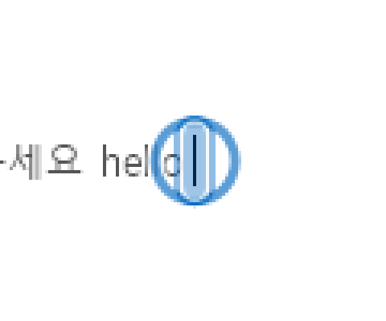 | 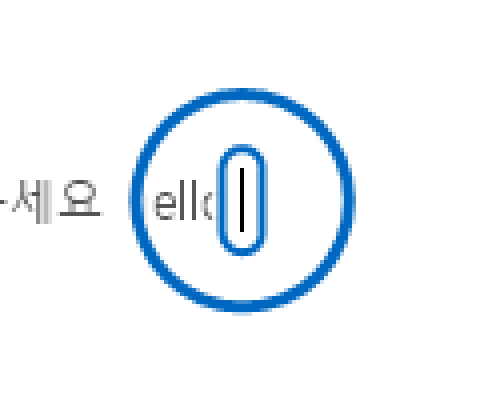 |

10절 전체: [이전](images/view-prd/vw03-sonar-sheet-before.png) · [이후](images/view-prd/vw03-sonar-sheet-after.png)(밝은 테마색 3줄 추가)

---

### VW-04 · 오버레이가 배지 크기·Windows 텍스트 크기를 따르게 (P2 · M3)

**문제** 배지는 `DpiScaleAt × SizePercent/100`(`BadgeForm.cs:1081`)로 그리는데 말풍선(`CaretOverlays.cs:157`)과 소나(`:98`)는 `DpiScaleAt` 만 쓴다. 배지를 130~200% 로 키운 사용자(지금 이 PC 도 130%)에게 말풍선만 기본 크기로 뜬다. Windows 접근성 "텍스트 크기"도 반영하지 않는다.

**결정**(2026-10-12, 구현 중): 말풍선은 배지 크기와 텍스트 크기를 **곱하지 않고 큰 쪽**을 쓰고 100~225% 로 묶는다(150%×150% = 2.25배처럼 겹쳐 커지지 않게, 50% 배지에서도 안내 글자는 줄지 않게). 소나는 배지 크기만 100~200% 로 묶는다(300% 배지에서 원이 화면을 덮지 않게).

**제안** `CalloutPlayer.Show`·`SonarPlayer.Play` 에 `sizePercent` 를 넘겨 배율에 곱한다. 말풍선 글자는 추가로 `HKCU\SOFTWARE\Microsoft\Accessibility\TextScaleFactor`(100~225)를 읽어 곱한다(값이 없으면 100). 소나 원은 텍스트 크기와 무관.

**완료 조건**

- [x] 배지 크기 150% 에서 말풍선·소나 원 굵기도 1.5배 → `CalloutStyleTests.Scale_FollowsBadgeSizeOrTextSize`, `SonarTests.Scale_FollowsBadgeSize`
- [x] 텍스트 크기 150% 에서 말풍선 글자만 1.5배(소나는 그대로) (소나는 `Sonar.Scale` 이 텍스트 크기를 받지 않음)
- [x] 말풍선 `MaxText` 는 배율과 함께 커져 줄바꿈 위치가 같다 — `MaxText × 배율` 이라 그대로

**구현 가이드** `CaretOverlays.cs` 두 메서드의 시그니처, `BadgeForm.ShowCallout`·`PlaySonar`. 텍스트 크기 읽기는 `Native` 또는 `Theme` 에 `TextScale()`.

**검증** 배지 크기 100/150/200% × 텍스트 크기 100/150%. — 단위 테스트로 계산 확인. 실제 화면은 VW-14

**결정** 없음.

---

### VW-05 · 오버레이 z-order (P3 · M4)

**문제** 배지 창은 활성 창이 최상위(TopMost)여도 그 위에 오도록 `RaiseAbove`(입력 큐 붙이기 포함)를 하지만 말풍선·소나 창은 처음 보일 때 `HWND_TOPMOST` 한 번뿐(`CaretOverlays.cs:67`). FlowLauncher 같은 최상위 창에서는 말풍선이 뒤에 숨을 수 있다.

**제안** `OverlayWindow.Present` 에서 보일 때마다 `Native.IsAbove(fg, Handle)` 를 확인하고 아니면 `BadgeForm.RaiseAbove` 와 같은 절차. 공용 함수로 뺀다.

**구현**(2026-10-12): 배지의 `RaiseToTop`/`RaiseAbove`(실패 3회 포기·응답 없는 창 건너뜀·마우스 누름 중 건너뜀 포함)를 `App/TopmostRaiser.cs` 로 옮기고, 배지·말풍선·소나 창이 각자 하나씩 쓴다. 배지 동작은 그대로(로그 문구만 `raise badge:` 로).

**완료 조건** [ ] 최상위 창(예: 작업 관리자 "항상 위") 입력칸에서 소나·말풍선이 위에 보인다. — 코드: `OverlayWindow.Present` 가 보일 때마다 `TopmostRaiser.KeepAboveForeground`(배지와 같은 절차). 실제 화면 확인은 VW-14

**검증** 작업 관리자 "항상 위" · FlowLauncher.

---

### VW-06 · 말풍선 [보기] + 확인 시트 100% 행 (P3 · M4)

**문제** 소나만 [보기] 가 있다. 비밀번호·포커스 뺏김 말풍선은 켜고 실제 상황을 만들어야 모습을 안다. `RenderSheet` 11절은 150% 만 그려 100% 가독성 문제가 그림에 안 보였다.

**제안** 비밀번호 칸 경고·포커스 뺏김 경고 카드에 [보기] 를 더해 그 카드 옆에 주의 말풍선을 한 번 띄운다(`IExperimentHost.PreviewCallout`). `RenderSheet` 11절에 100% 행을 더하고, 10절에 밝은 테마색 행을 더한다(VW-03 과 겹치면 그쪽에서).

**완료 조건** [ ] 두 카드의 [보기] 가 동작 · [ ] 시트 11절 100% 행 · [ ] 영어 문구 포함(`Strings` 둘 다).

---

### VW-07 · 밝은 배지색이 흰 문서 위에서 윤곽이 약함 — 바깥 어두운 림 (P1 · M2)

**문제** UX-01 은 어두운 배지색(클래식 a #3C3C3C 등)에 바깥 **흰** 림을 둘러 어두운 편집기에서 보이게 했다. 그 반대 — 밝은 배지색(미드나잇 한 #F2C75C 1.60, 민트 한 #7FD8C4 1.68, 벚꽃 한 #F29CBF 2.04 vs 흰색)이 흰 문서 위에서 윤곽이 없는 문제는 그대로다. 점·밑줄 모양에서 특히 심하다(글자가 없어 윤곽이 전부).

**근거** 1.3 표, V-1 캡처. `ColorHex.OuterRimAlpha`(`Settings.cs` 안)는 어두운 편집기 바탕만 기준으로 흰 림 알파를 정한다. `EdgeOn` 은 배지색 대비 1.6 목표라 밝은 색의 테두리는 흰색과 2~2.5:1.

**제안**

1. `ColorHex.OuterRimAlphaDark(fill)`: 흰 문서(#FFFFFF) 와의 대비가 `OutlineContrast`(3:1) 에 못 미치면, 그 위에 어두운 선(#1F1F1F)을 얹었을 때 흰 문서와 3:1 이 되는 가장 낮은 알파. 어두운 편집기 위에서는 거의 보이지 않는다(거울상).
2. `BadgeRenderer.DrawOuterRim` 이 흰 림과 어두운 림을 **둘 다** 그린다(필요한 쪽만 알파 > 0). 트레이 아이콘(`TrayIcons.RenderState`)도 같은 규칙.
3. 소나 원의 바깥 윤곽(VW-03)도 이 함수를 쓴다.
4. 고대비는 변경 없음.

**완료 조건**

- [x] 단위 테스트: 다섯 테마 × 한/영 × 흰(#FFFFFF)·어두운(#1E1E1E) 바탕에서 "윤곽으로 보이는 가장 바깥 선"의 대비가 3:1 이상 → `DesignThemesTests.Outline_IsVisibleOnWhiteDocument_ForEveryColor`(견본 11색 + 기본 3색 × 5테마). 어두운 편집기 쪽은 UX-01 테스트
- [x] 클래식 한(#0067C0, 흰 5.67)·a 는 모습 변화 없음(어두운 림 알파 0) → `OuterShade_OnlyAroundLightFills`
- [x] `RenderSheet` 1·3·8절의 밝은 배경 행에서 미드나잇·민트·벚꽃 배지 윤곽이 보인다 — 아래 결과 그림
- [ ] 트레이 아이콘: 밝은 작업 표시줄(밝게 모드)에서 금색 "한" 아이콘 윤곽이 보인다 — 시트 4절에서 금색 아이콘 가장자리 확인(흰 칸). 실제 밝은 작업 표시줄은 VW-14

**구현 가이드** `src/ImeBadge.Core/Settings.cs` `ColorHex`(`OuterRimAlpha` 옆), `src/ImeBadge/Render/BadgeRenderer.cs` `DrawOuterRim`·`OuterRimWidth`, `src/ImeBadge/App/TrayIcons.cs` `RenderState`. 테스트는 `tests/ImeBadge.Core.Tests/DesignThemesTests.cs` 옆에.

**검증** 메모장(흰)·Word·VS Code 에서 미드나잇 점·밑줄·둥근 모양. 불투명도 60%·30% 에서도 자리가 보이는지.

**결정** 없음. (UX-01 에서 "기본색은 유지" 로 결정한 것과 같은 방향 — 색은 그대로, 윤곽만.) 구현 중 정한 것(2026-10-12): 림 색은 검정 대신 배지색을 35% 로 진하게 한 같은 색조(금색 → 짙은 갈색), 함수 이름은 `ColorHex.OuterShadeColor/OuterShadeAlpha`, 렌더러·트레이·소나가 함께 쓰도록 `BadgeRenderer.OuterRimColor` 로 묶음. "흰 림과 어두운 림이 둘 다 필요한 색은 없다" 를 `NoColor_NeedsBothRims` 로 확인.

**결과** (확인 시트 1절, 150%. 미드나잇 줄 3배 확대)

| | 이전 | 이후 |
|---|---|---|
| 흰 바탕 |  |  |
| 어두운 바탕(이후, 변화 거의 없음) | | 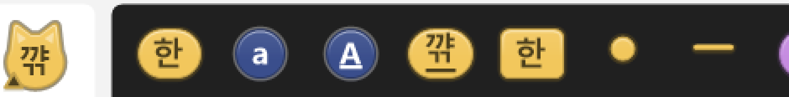 |

테마 전체(흰 바탕, 150%): [이전](images/view-prd/vw07-themes-on-white-150-before.png) · [이후](images/view-prd/vw07-themes-on-white-150-after.png)

---

### VW-08 · 점·밑줄 모양의 특수 키 표시가 너무 작음 (P2 · M2)

**문제** 점(지름 9px)·밑줄 아래 한 줄에 그리는 ▲(3px) ▁(7×2px) ■(3px) 이 100% 에서 서로 구별되지 않고, 벚꽃·30% 불투명도에서는 점과 함께 묻힌다(1.4 그림). `OutsideTriH = 3f`, `OutsideBarW = 7f, OutsideBarH = 2f`.

**제안**

1. 기호 높이 3 → 4px(▲ 밑변 5.4 → 6), ■ 4px, ▁ 8×2.5px. 자리 계산(`BadgeLayout.Tail/Side`)을 함께 키운다(점·밑줄 몸통 자리는 그대로).
2. 기호에도 VW-07 의 양방향 림을 적용(이미 몸통과 같은 테두리·그림자를 쓰므로 `DrawOuterRim` 호출만 바뀐다).
3. 점 모양의 Caps Lock 은 ▁ 대신 **점 안의 흰 점**(이중 원)으로 하는 안도 검토 — 자리 차지 없이 점 자체가 바뀌어 더 잘 보인다. 결정 필요.

**완료 조건**

- [x] `RenderSheet` 8절 100%×3 에서 ▲ ▁ ■ 이 셋 다 구별된다 — 아래 결과 그림
- [x] `BadgeLayoutTests`: 표시를 켜고 꺼도 점·밑줄 몸통 자리가 같다(기존 테스트 유지) (기존 테스트 통과) + 기호 줄이 자리 안에 들어가는지 `MarkRow_FitsItsRoom`(배율 5가지)
- [x] 글자 배지의 모서리 표시(`CornerMarkSize 5`)는 변경 없음

**구현 가이드** `BadgeRenderer.cs` `OutsideGap/OutsideBarW/OutsideBarH/OutsideTriH`, `DrawMarksBelow`; `BadgeLayout.Tail/Side`.

**결정** 점 모양의 Caps Lock 표시를 ▁ 로 둘지 이중 원으로 바꿀지. 결정(2026-10-12): **▁ 유지**. 다른 모양(글자 배지·밑줄)과 설정 창 특수 키 카드의 범례(▁ ▲ ■)가 같은 기호를 써서, 점만 다른 기호를 쓰면 범례가 맞지 않는다.

구현 중 정한 것: ▁ 은 8×2.5 대신 **9×2**(홀수 폭이라 점 지름 9 의 가운데에 픽셀 경계가 맞고, 정수 높이라 흐리지 않음), ▲ 밑변 6. 치수를 `BadgeLayout.Mark*` 상수(Core)로 옮겨 렌더러와 자리 계산이 같은 값을 쓴다. `Side`(점 6 → 9, 밑줄 3 → 5)·`Tail`(점 4 → 6, 밑줄 6 → 7, 배율 1)을 키웠고 몸통 자리는 그대로다.

**결과** (확인 시트 8절 일부. 왼쪽 밝게 150%, 가운데 어둡게 150%, 오른쪽 100%×3)

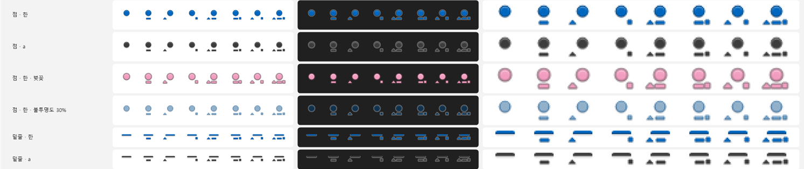
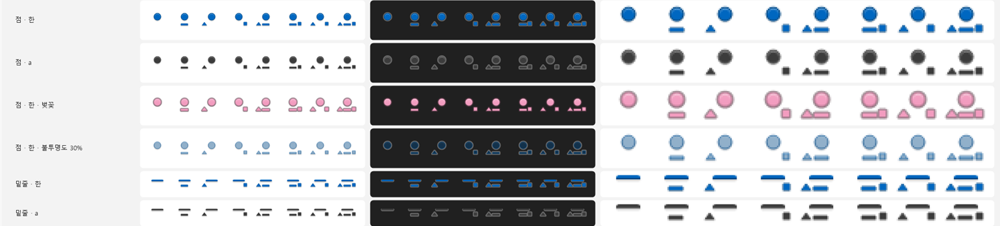

---

### VW-09 · 아래쪽 배치에서 배지가 다음 줄 글자를 가림 (P2 · M3)

**문제** 아래쪽 배치(오른쪽 아래·왼쪽 아래·아래)는 `caret.Bottom + gap(3px)` 에 배지를 놓는다. 줄 간격이 촘촘한 편집기에서 배지가 다음 줄 글자 위에 얹힌다. 점 모양 130% 에서 점 지름 12px + 틈 4px 가 다음 줄 x-height 를 덮는다(V-2, 설정 창 미리보기와 자체 입력창 캡처 모두에서 확인).

**근거** `BadgeLayout.cs:87` `pos = … caret.Bottom + gap`. 설정 창 미리보기(1.6 그림)에서 금색 점이 "헌" 위에.

**제안 (택일 또는 조합)**

- (a) 점·밑줄 모양은 아래쪽 배치에서 틈을 0~1px 로 줄이고 점을 커서 높이의 40% 로 제한해 **줄 사이 공간 안**에 들어가게 한다.
- (b) 아래쪽 배치에서 caret 높이가 작으면(≤ 배지 높이) 자동으로 **오른쪽**(커서 옆, 같은 줄)으로 옮긴다 — 지금 "왼쪽에 자리가 없으면 오른쪽으로" 와 같은 식의 규칙.
- (c) 아래쪽 배치일 때 배지를 반투명(60%)으로 그려 겹쳐도 글자가 비치게 한다(표시 방식 "타이핑 중 옅게" 와 비슷).

**완료 조건**

- [x] 위치 카드 자세히 설명에 '타이핑 중에는 옅게' 로 잇는 안내(한국어·영어, `StringsTests` 통과)
- [ ] ~~`BadgeLayoutTests` 에 "caret 높이 16, 점 130%, 아래쪽 배치 → 점 아래끝이 caret.Bottom + 줄간격(1.3×16) 안" 같은 경계 테스트~~ — 결정 (d) 로 배치를 바꾸지 않아 해당 없음
- [ ] ~~설정 창 미리보기에서 점이 다음 줄 글자에 얹히지 않는다~~ — 미리보기는 실제 동작을 그대로 보여 주는 것이라 그대로 둔다(결정 (d))
- [x] 위쪽 배치·글자 배지는 변경 없음

**검증** 메모장(줄 간격 1.2)·VS Code·카카오톡 입력칸에서 점·밑줄·둥근 모양의 아래쪽 배치.

**결정**(2026-10-12): **(d) 배치는 그대로, 해결책으로 이어 주는 안내.** 따져 본 결과 이 겹침은 위치 계산의 결함이 아니라 "아래" 를 고른 결과다. caret 높이가 곧 줄 높이라 아래에 두면 틈을 어떻게 줘도 다음 줄의 글자 영역에 걸친다. (a) 틈 줄이기는 지름 12px(130%) 점이 줄 사이 공간에 들어갈 수 없어 효과가 거의 없고, (b) 자동으로 오른쪽 이동은 사용자가 고른 위치를 앱이 바꿔 혼란스럽고, (c) 아래일 때 반투명은 이미 있는 표시 방식 "타이핑 중에는 옅게" 와 겹친다. 그래서 위치 카드의 자세히 설명("위쪽이 다음 줄 글자를 덜 가립니다")에 그 표시 방식으로 가는 안내를 더했다.

---

### VW-10 · 트레이 아이콘 16px "한" 뭉개짐 (P3 · M4)

**문제** 100% 배율의 트레이 아이콘은 16px 인데 "한" 은 획이 많아 11px Bold 로는 뭉개진다(1.5 그림). "A" 는 괜찮다.

**제안** 16px 전용 분기: (a) 글자 크기 0.68 → 0.74 + Regular 굵기(획 사이 틈 확보), 또는 (b) 획이 적은 "가" 로 바꾸되 설정 창·README 의 설명을 맞춘다(Windows 한국어 IME 표시기는 "한" 이라 (a) 우선). 20px 이상은 변경 없음.

**완료 조건** [ ] `RenderSheet` 4절 16px×4 에서 "한" 의 ㅎ·ㅏ·ㄴ 획이 분리되어 보인다 · [ ] 24px 이상 변경 없음.

**구현 가이드** `TrayIcons.RenderState` 의 `px` 계산.

**결정** (a)/(b). 결정: _(미정, 기본 (a))_

---

### VW-11 · 불투명 배지 글자에 ClearType 적용 검토 (P3 · M4)

**문제** 배지 글자도 회색 안티앨리어싱이다. 13px Bold 라 말풍선만큼 흐리지는 않지만 100% 에서 "한" 이 부드럽다(`RenderSheet` 3절 100%×3). 불투명도 100% 이면 몸통이 불투명하므로 VW-01 의 기법을 쓸 수 있다.

**제안** VW-01 완료 뒤, 불투명도 100% 이고 고대비가 아닐 때만 ClearType 경로. 펄스 프레임은 기본 그림 확대라 그대로(#47). 효과가 미미하면 ❌ 취소.

**완료 조건** [ ] 100%×3 전후 비교 캡처 · [ ] 불투명도 < 100% 는 변경 없음 · [ ] 성능(그리기 시간) 1ms 이내 증가.

---

### VW-12 · 대화상자가 어둡게 모드를 따르지 않음 (P2 · M3)

**문제** 단축키 등록 실패·업데이트 결과·치명적 오류 등 대화상자는 Win32 `TaskDialog`(`Dialogs.cs`)라 늘 **밝은** 창으로 뜬다. 어두운 설정 창·트레이 메뉴 위에 흰 대화상자가 떠 테마가 깨진다. `UpdateProgressForm` 은 자체 테마를 입혀 어둡다 — 둘이 다르다.

**제안** `Dialogs` 를 자체 `ThemedDialog`(Form + `Theme.Apply` + `ApplyTitleBar`)로 바꾼다: 아이콘 + 제목 + 본문 + 명령 링크(`AccentButton`) + "자세히" 펼침(`ChevronButton` 재사용). 치명적 오류(`CrashHandler.Fatal`)처럼 UI 스레드가 없을 수 있는 경우는 지금처럼 TaskDialog/MessageBox 로 물러난다.

**완료 조건**

- [x] 어둡게 모드에서 단축키 충돌 경고·업데이트 "최신입니다"·설정 가져오기 오류가 어두운 대화상자로 뜬다 — 확인 시트 13절(정보·주의·고르기 × 밝게/어둡게). 실제 화면은 VW-14
- [ ] 키보드: Enter/Esc, Tab 순서, Alt 니모닉 — 코드: Accept/Cancel = [닫기], Esc = 고르지 않음(-1), 명령 링크 TabIndex 순서·Enter/Space. 실제 키 입력 확인은 VW-14
- [x] 고대비: 시스템 색 — 고대비면 `ThemedDialog` 대신 TaskDialog
- [x] 치명적 오류 경로는 변경 없음

**구현 가이드** `src/ImeBadge/App/Dialogs.cs` 의 `Info/Warning/Choose` 시그니처를 유지한 채 내부 구현만 교체. `UpdateProgressForm.cs` 의 테마 적용 코드를 참고.

**검증** 밝게/어둡게·고대비·100%/150%·한국어/English. — 확인 시트 13절로 밝게/어둡게(100%, 한국어) 확인. 나머지는 VW-14.

**구현 중 정한 것**(2026-10-12): 고대비 모드는 자체 대화상자 대신 시스템이 그리는 TaskDialog(사용자가 고른 대비를 정확히 따름). 대화상자를 띄울 때 이 프로그램의 창(설정 창)이 앞에 있으면 그 가운데에, 아니면 화면 가운데에 작업 표시줄 단추와 함께. 모양을 CI 에서도 보도록 확인 시트에 13절(화면 밖에 띄워 `DrawToBitmap`)을 더했다 — 이때 생성자에서 `ActiveControl` 을 정하면 예외가 나는 것을 찾아 고쳤다(그대로였으면 실제 앱에서도 늘 TaskDialog 로 물러났을 것).

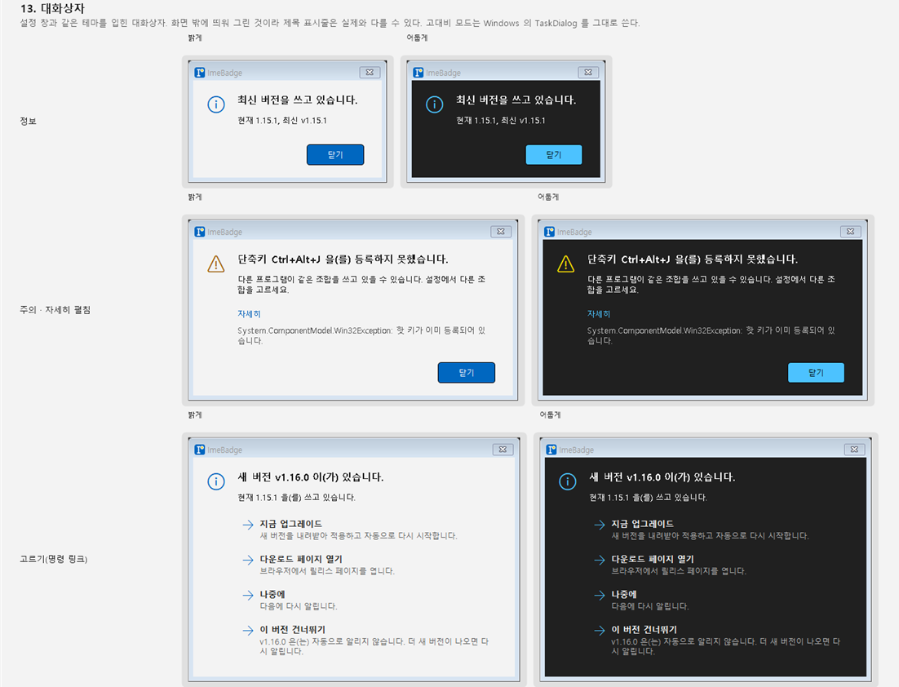

---

### VW-13 · 설정 창 미리보기에 "문서 위 가독성" 상황 추가 (P3 · M4)

**문제** 미리보기는 밝은·어두운 두 칸뿐이라 VW-07 의 효과(흰 문서 위 윤곽)와 선택 영역 점선, 불투명도 낮춘 모습을 설정 창에서 확인하기 어렵다.

**제안** 미리보기의 밝은 칸 아래 줄에 "선택 영역 위"(파란 선택 배경 + 점선 배지)를, 어두운 칸에 "불투명도 적용" 줄을 둔다. 줄 수는 그대로(기존 줄 하나를 바꾼다). VW-07·08 뒤에.

**완료 조건** [ ] 미리보기 줄 라벨 한/영 · [ ] 창 최소 크기에서 잘리지 않음.

---

### VW-14 · 밝게 앱 모드·고대비·125/150% 배율 전수 캡처 검증 (P2 · M4)

**문제** 이 문서의 캡처는 어둡게 앱 모드·100% 한 대 모니터에서만 찍었다. 밝게 모드의 설정 창·트레이 메뉴, 고대비 4종, 125/150% 의 오버레이는 확인하지 못했다.

**제안** 그 조합에서 설정 창 6페이지·트레이 메뉴·말풍선 2종·소나·대화상자 1종을 캡처해 `docs/images/view-prd/` 에 두고, 발견한 문제는 0.7 에 `V-N` 으로 적어 항목을 추가한다.

**완료 조건** [ ] 밝게 · [ ] 고대비(수족관·사막·황혼·밤하늘) · [ ] 125% · [ ] 150% · [ ] 발견 사항 0.7 등록.

---

## 부록 A. 측정값과 재현 방법

- 대비율은 WCAG 2.x 상대 휘도 공식. 1.3 표는 테마 기본색 그대로(불투명도 100%).
- 말풍선 100% 재현(1.1 그림)은 PowerShell + System.Drawing 으로 같은 글꼴(맑은 고딕)·크기·`TextRenderingHint` 를 써서 그렸다. 앱 코드로 그린 비교는 VW-01 에서 바꿔 넣는다.
- GDI+ 픽셀 정렬 확인: `PixelOffsetMode.HighQuality` + 좌표 `+0.5` + 1px 펜 → 한 픽셀 폭의 또렷한 선(검증함). 배지·말풍선의 현재 규칙은 맞다. 흐림의 원인은 선 정렬이 아니라 글자 크기·힌트·색·반투명 채움이다.
- 설정 창 캡처는 `PrintWindow(PW_RENDERFULLCONTENT)`, 배지·오버레이 캡처는 `Graphics.CopyFromScreen`(레이어드 창은 PrintWindow 에 잡히지 않는다).

## 부록 B. 조사 중 관찰한 비-View 사항 (이 문서 범위 밖, 참고용)

| # | 관찰 | 어디서 | 비고 |
|---|---|---|---|
| B-1 | "모든 프로그램에서 한/영 유지" 가 WinForms TextBox 에 IME 요청 → 한/영 키 순서로 보냈는데, 그 뒤 읽힌 상태가 `open=1 mode=0x0` 이고 배지는 영문. 기억한 모드(한글)로 맞춰지지 않은 채 한 창 한 번 규칙으로 멈춤 | `--debug` 로그 11:59:19 | 한 번 관찰. 재현되면 `ImeModeKeeper`/`ImeWriter` 이슈로 |
| B-2 | `errors.log` 에 카카오톡 caret 질의 50~60초 지연(UIA/MSAA) 4건 | errors.log 2026-10-12 11:48 | 배지 멈춤으로 보일 수 있음. `DeadlineWorker` 시간 제한 확인 |
| B-3 | 말풍선을 끌 방법이 없음(클릭 통과, 5~6초 대기). 타이핑이 이어지면 내리는 규칙이 자연스러움 | `CalloutPlayer` | UX 항목 후보 |
| B-4 | 비밀번호 칸 경고에 소리 옵션이 없음. 시선이 다른 곳에 있거나 화면 읽기 프로그램 사용자는 놓침 | `WarnPassword` | 접근성 항목 후보 |
| B-5 | 포커스 뺏김 지켜보기(700ms) 동안 "절약"(250ms) 모드에서는 2~3번만 확인 | `WatchForFocusSteal` | 지켜보는 동안만 50ms 로 |
